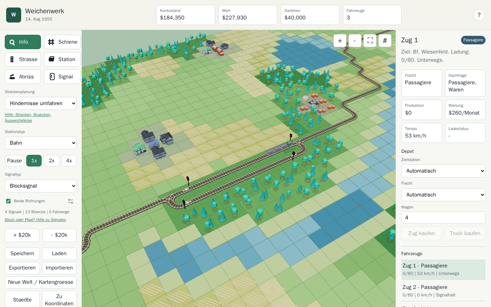
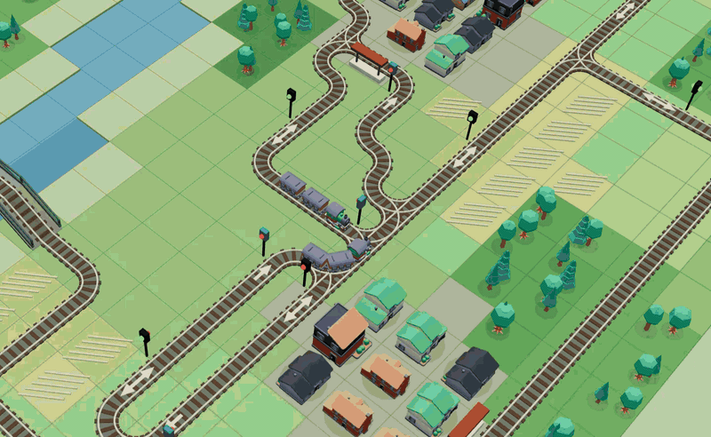
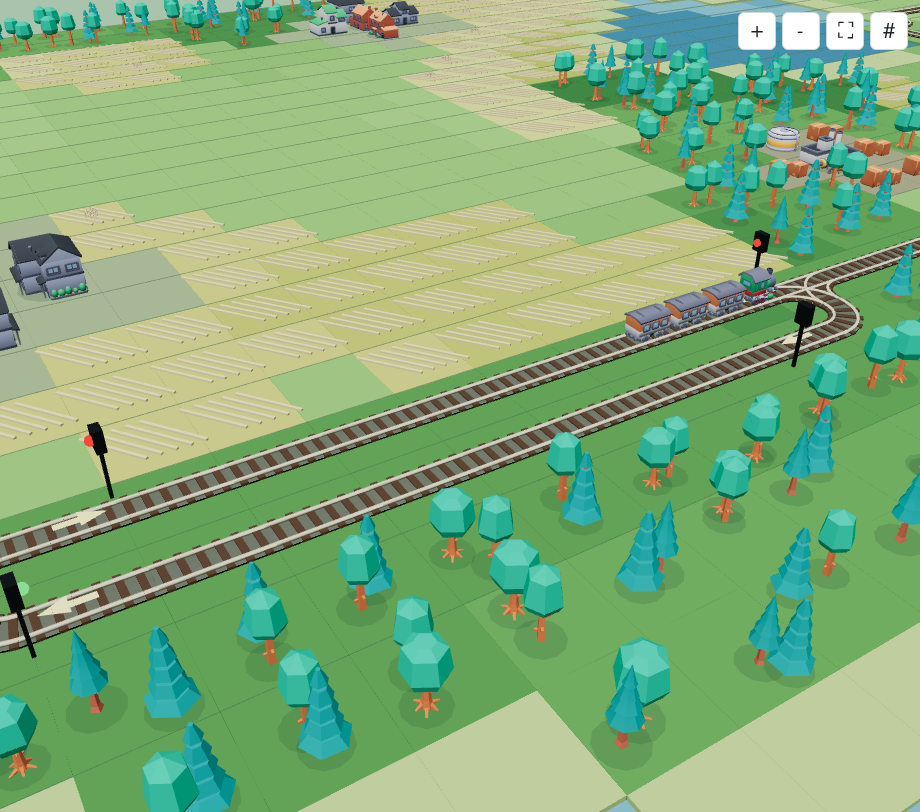
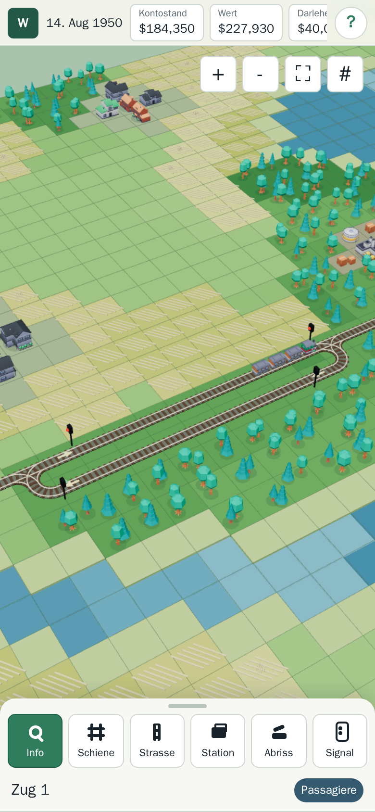
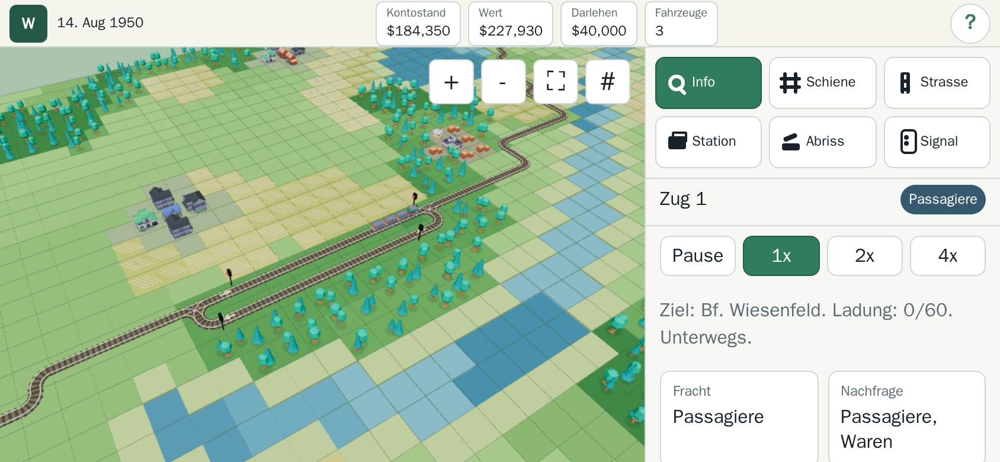
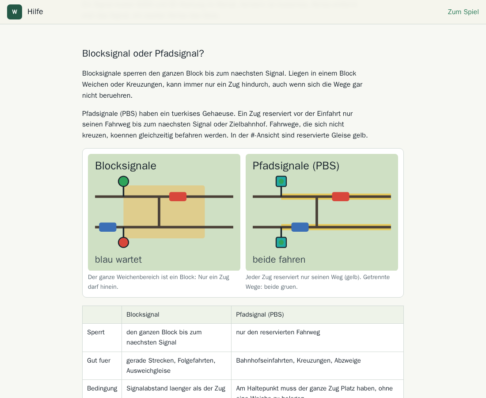

# Weichenwerk

Eine kleine, von OpenTTD inspirierte Eisenbahn- und Transportsimulation fuer den Browser: Strecken ziehen, Weichen und Signale tuefteln, Ausweichgleise bauen und den Zuegen beim Fahren zusehen. Laeuft am PC und am Handy, ohne Installation, ohne Server und auch offline.

**[Jetzt im Browser spielen](https://dg1001.github.io/weichenwerk/)**

  
  

## Was man machen kann

- Schienen und Strassen per Ziehen planen, Vorschau mit Preis, erst **Bauen** baut
- Bahnhoefe und Truck-Stationen an Staedten und Industrien; Passagiere, Kohle, Getreide und Waren
- Zuege mit mehreren Wagen, Trucks, Fahrphysik mit Beschleunigen und Bremsen, Mitfahren im Fuehrerhaus
- Block- und Pfadsignale (PBS), Einwegsignale, Bruecken ueber Wasser
- Werkzeug **Ausweichgleis mit Signalen**: Gleis, Weichen und vier Signale in einem Schritt
- Wachsende Staedte, Darlehen, Monatsabrechnung, zufaellige Landschaften mit Seed
- Optionale **Aufgaben**, die aufeinander aufbauen und schwieriger werden; Standard bleibt freies Bauen
- Eingebaute **Hilfe mit Bildern**, z. B. zu Block- vs. Pfadsignal und zum Bau von Ausweichgleisen

## Bedienung

| | Handy / Tablet | PC |
|---|---|---|
| Karte verschieben | ein Finger | linke Maustaste ziehen (mit Schiene/Strasse: Umschalt + ziehen) oder mittlere Maustaste |
| Zoomen | zwei Finger auseinander/zusammen | Mausrad |
| Drehen | zwei Finger verdrehen | rechte Maustaste |
| Strecke zeichnen | mit einem Finger ziehen (Lupe zeigt das Zielfeld) | linke Maustaste ziehen |

Am Handy fuellt die Karte den Bildschirm; Werkzeuge und Infos liegen hochkant unten, quer rechts. Ueber HTTPS (z. B. GitHub Pages) laesst sich Weichenwerk als App auf dem Startbildschirm installieren und offline spielen.

## Starten

- Online: [dg1001.github.io/weichenwerk](https://dg1001.github.io/weichenwerk/)
- Lokal: Repository herunterladen und `index.html` im Browser oeffnen. Kein Build-Schritt, kein Server, keine Netzabrufe; Three.js, Bibliotheken und Modelle liegen bei. Ein Browser mit WebGL ist noetig.

## Entstehung

Weichenwerk wurde in einem [XaresAICoder](https://github.com/DG1001/XaresAICoder)-Workspace entwickelt, mit Hilfe der KI-Modelle GPT 6.1 Sol und Claude Opus 5.5. Der Entwicklungsverlauf steht in [devlog.md](devlog.md).

## Dokumentation

- [help.html](help.html): Spielhilfe mit Bildern, im Spiel ueber **?** oben rechts
- [fachlich.md](fachlich.md): Spielregeln, Bedienung, Kosten und Grenzen
- [technisch.md](technisch.md): Aufbau des Codes, Spielstaende, Tests, Veroeffentlichung
- [devlog.md](devlog.md): Entwicklungsverlauf
- [OPENTTD-AUDIT.md](OPENTTD-AUDIT.md): Vergleich mit OpenTTD

## Tests

Jeder Test ist ein eigenstaendiges Node-Skript, z. B. `node tests/railway.cjs`. Tests ohne `browser` im Namen brauchen nur Node und laufen bei jedem Push in GitHub Actions, bevor die Seite veroeffentlicht wird. Die Browser-Tests brauchen Playwright; Einrichtung und vollstaendige Liste in [technisch.md](technisch.md#tests).

## Lizenz

Der eigene Code steht unter der [MIT-Lizenz](LICENSE). Eingebundene Fremdbestandteile behalten ihre Lizenzen; die Lizenztexte liegen jeweils bei:

| Bestandteil | Lizenz | Hinweise |
|---|---|---|
| [Three.js](https://threejs.org) 0.164.1 | MIT | `src/vendor/three-LICENSE.txt` |
| [PathFinding.js](https://github.com/qiao/PathFinding.js) 0.4.18 mit heap 0.2.5 | MIT, PSF | `src/vendor/pathfinding-README.md`, `src/vendor/heap-README.md` |
| [simplex-noise](https://github.com/jwagner/simplex-noise.js) 4.0.3 | MIT | `src/vendor/simplex-noise-LICENSE.txt` |
| 3D-Modelle von [Kenney](https://kenney.nl) (City Kit Suburban/Industrial, Nature Kit, Train Kit, Car Kit) | CC0 1.0 | `src/assets/licenses/`, `src/assets/README.md` |
| Icons von [Lucide](https://lucide.dev) 0.468.0 | ISC | `src/assets/icons/LICENSE.txt` |

Weichenwerk ist ein unabhaengiges Projekt und steht in keiner Verbindung zu OpenTTD oder zu den Inhabern der Marke "Transport Tycoon".
